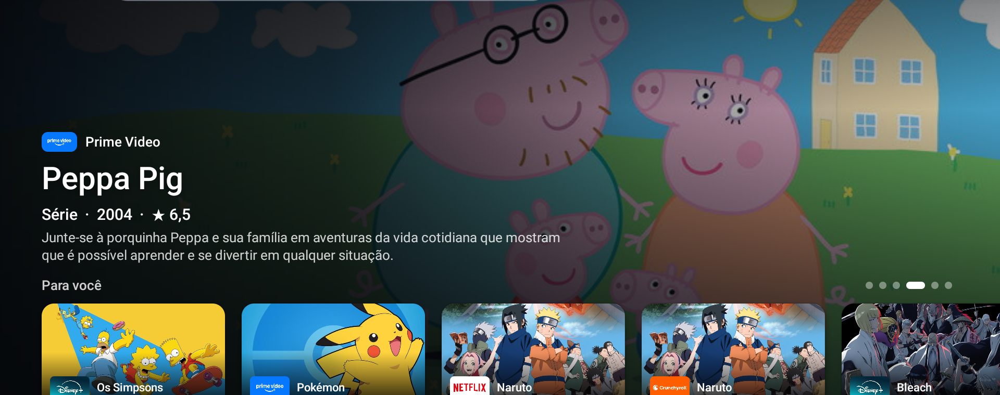
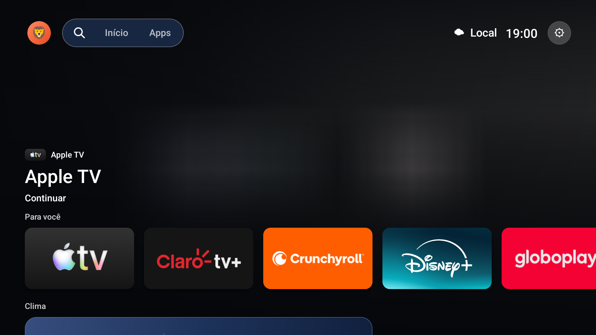
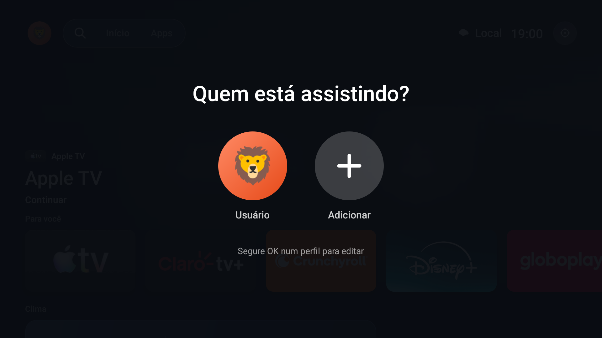
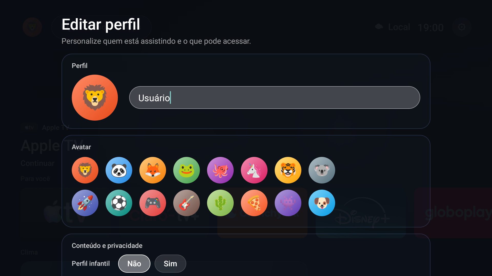
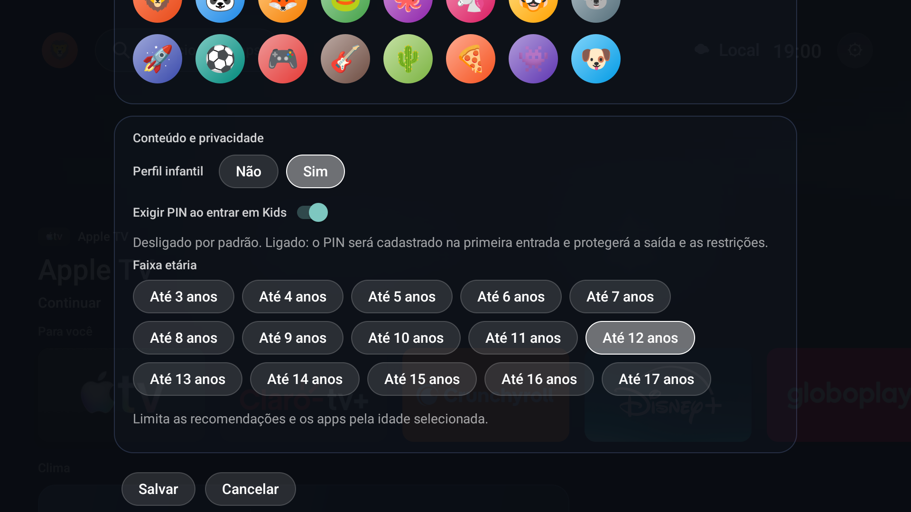
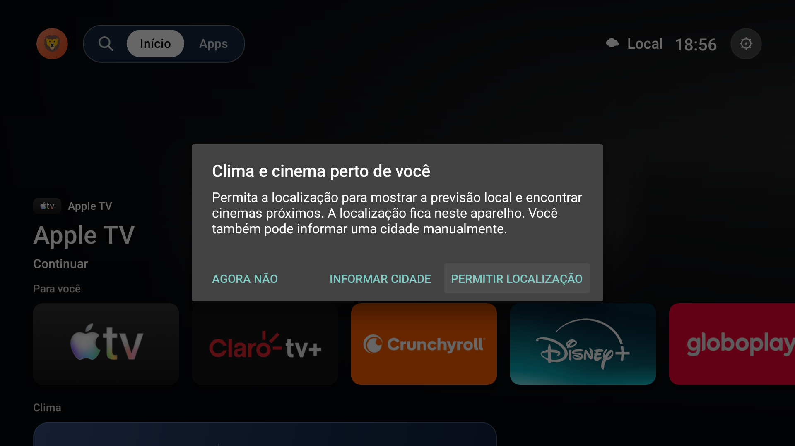
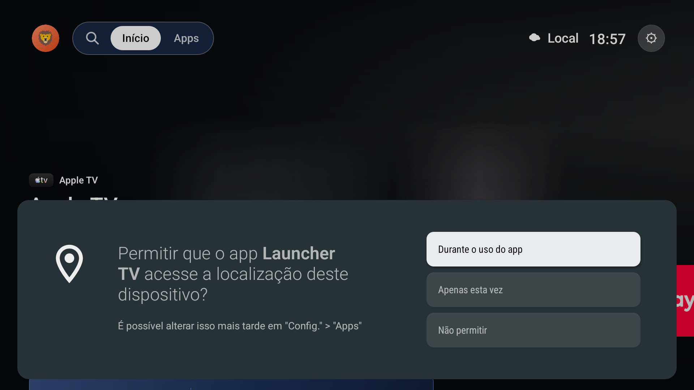

# Launcher TV

[English](README.en.md) | [Português](README.md)

Uma alternativa moderna ao launcher padrão da sua Android TV, desenvolvida em Java. Reúne destaques de filmes e séries, aplicativos, histórico de reprodução por perfil, clima e cinema. Esta variante não inclui a seção de Canais nem integração com Home Assistant. Não usa Gradle: o build é um script que chama as ferramentas do Android SDK.

## Índice

- [Recursos](#recursos)
- [Capturas de tela](#capturas-de-tela)
  - [Home com TMDB configurado](#home-com-tmdb-configurado)
  - [Tela inicial e perfis](#tela-inicial-e-perfis)
  - [Primeira execução e localização](#primeira-execução-e-localização)
- [Requisitos](#requisitos)
- [Serviços externos e chaves](#serviços-externos-e-chaves)
- [Configuração](#configuração)
- [Compilar](#compilar)
- [Preparar a TV e instalar](#preparar-a-tv-e-instalar)
  - [Antes de conectar](#antes-de-conectar)
  - [Compilar e instalar](#compilar-e-instalar)
  - [Permissões e primeira abertura](#permissões-e-primeira-abertura)
- [Limitações conhecidas](#limitações-conhecidas)
- [Testes e compatibilidade](#testes-e-compatibilidade)
  - [Atualizar sem perder dados](#atualizar-sem-perder-dados)
- [Isenção de garantias e responsabilidade](#isenção-de-garantias-e-responsabilidade)
- [Dados e privacidade](#dados-e-privacidade)
- [Estrutura do projeto](#estrutura-do-projeto)
- [Contribuindo](#contribuindo)

## Recursos

- **Início:** destaques de filmes e séries, "Continue de onde parou", apps mais usados, Minha lista, clima dos próximos sete dias, filmes em cartaz e lembretes de cinema.
- **Filmes e Séries:** destaques e imagens do TMDB, ligados aos serviços de streaming instalados na TV.
- **Apps:** grade com todos os aplicativos que têm atividade de abertura. Segurar OK abre o menu: abrir, mover (esquerda, direita, cima e baixo), informações do app, favoritos, ocultar e desinstalar.
- **Perfis:** cria automaticamente o perfil local **Usuário** na primeira execução; ele pode ser renomeado e complementado com outros perfis. Cada perfil tem avatar, histórico e preferências separados. Em cada perfil, escolha **Perfil infantil: Sim ou Não**. No modo Kids, escolha uma idade de 3 a 17 anos para limitar recomendações e apps. Opcionalmente, ative **Exigir PIN ao entrar em Kids**; o PIN de pelo menos quatro números é cadastrado na primeira entrada e protege a saída do perfil e a alteração das restrições.
- **Continue de onde parou:** acompanha as sessões de mídia dos apps e retoma o conteúdo quando o app informa o destino.
- **Busca:** pesquisa unificada por conteúdo e aplicativos, com ditado por voz quando a TV oferece.
- **Clima:** previsão atual e de sete dias (Open-Meteo), com localização automática ou cidade informada. O tema acompanha o horário local, sem coordenadas de uma cidade fixa no código.
- **Cinema:** filmes em cartaz da sua cidade; segurar OK mostra sessões e permite criar lembretes.
- **Acessibilidade:** texto ampliado e foco mais visível.
- **Atalhos do controle:** os botões físicos de aplicativos (como Netflix e YouTube) abrem o app de qualquer tela, quando o serviço de acessibilidade está ativo.

## Capturas de tela

As imagens abaixo foram capturadas em uma Android TV TCL. Destaques e recomendações variam conforme o cache e os serviços configurados. As opções Kids e PIN exibidas no formulário são uma demonstração; não foram salvas no perfil da TV.

### Home com TMDB configurado



Captura na TCL com a chave do TMDB ativa. A barra superior foi cortada porque a captura veio da versão completa do launcher; esta variante pública não inclui Canais nem Home Assistant.

### Tela inicial e perfis









### Primeira execução e localização

Estas telas mostram a explicação do Launcher TV e a solicitação de localização do Android. Foram capturadas sem conceder a permissão.





## Requisitos

- Android TV com Android 9 (API 28) ou superior.
- JDK com `javac` e `keytool`.
- Android SDK com `aapt2`, `d8`, `zipalign`, `apksigner`, `core-lambda-stubs.jar` e pelo menos uma plataforma Android instalada.
- ADB, para instalar na TV (depuração por rede ou USB habilitada).

O `build.sh` usa as ferramentas mais recentes encontradas no SDK. Defina `ANDROID_HOME` com o caminho do seu SDK; sem isso ele procura em `/opt/homebrew/share/android-commandlinetools`.

## Serviços externos e chaves

O launcher usa os serviços abaixo. Apenas o TMDB exige uma chave de API para os recursos de filmes e séries.

| Serviço | Para que serve | Chave | Onde criar |
|---|---|---|---|
| TMDB | Destaques, filmes, séries, imagens e classificação indicativa | Obrigatória para Filmes, Séries e recomendações | Crie uma conta gratuita em <https://www.themoviedb.org> e gere a chave em **Configurações → API** (<https://www.themoviedb.org/settings/api>). Use a *API Key (v3)* |
| Open-Meteo | Previsão do tempo | Não precisa | <https://open-meteo.com> |
| Open Cinema Project | Sessões próximas, horários, cinemas e links de ingresso | Fonte pública | Consulta por localização; cobertura varia por cidade |

Este produto usa a API do TMDB, mas não é endossado nem certificado pelo TMDB.

## Configuração

Para uma experiência mais completa, recomenda-se cadastrar uma chave do TMDB. Ela habilita Filmes, Séries, recomendações e fornece dados de filmes em cartaz quando não há sessões disponíveis. Crie `config.properties` na raiz do projeto:

```properties
tmdb_key=SUA_CHAVE_DA_API_TMDB
```

Sem `tmdb_key`, as abas Filmes e Séries ficam ocultas, as recomendações não são carregadas e o app remove o cache antigo do TMDB para não exibir conteúdo de uma instalação anterior. A seção Cinema continua disponível: consulta as sessões públicas do Open Cinema Project quando há localização e, se não houver sessões, usa o TMDB para listar filmes em cartaz quando a chave está configurada. A cobertura do Open Cinema Project varia por cidade. Não é necessário configurar parceria com a Ingresso.com. `config.properties` está no `.gitignore`. Se o arquivo não existir, o build prossegue sem a integração do TMDB e não cria chaves vazias.

> **Atenção:** a chave do TMDB é incorporada ao APK durante a compilação e pode ser extraída do aplicativo. Não publique nem compartilhe APKs compilados com uma chave pessoal. Cada pessoa deve criar sua própria chave e compilar seu próprio APK.

## Compilar

```sh
./build.sh
```

O resultado é `LauncherTV.apk`. A cada build, o APK anterior é copiado para `backups/builds/` com seu SHA-256.

No primeiro build, o script pede uma senha e cria `sala.keystore` para assinar o APK. **Guarde esse arquivo em local seguro**: atualizações só instalam sobre o app existente se forem assinadas com o mesmo certificado. Ele também está no `.gitignore`; a senha não é gravada no projeto.

Cada usuário sem o app instalado pode compilar com a keystore criada no primeiro build e executar `adb install LauncherTV.apk`. Para atualizações futuras, conserve e reutilize essa mesma keystore.

## Preparar a TV e instalar

A instalação é feita por ADB. Você é responsável por confirmar o modelo e a versão do Android TV, revisar as permissões e decidir se quer instalar este software. O ADB permite controlar o dispositivo; conecte somente sua própria TV e seu próprio computador.

### Antes de conectar

Na TV, habilite as opções de desenvolvedor (em geral, em **Configurações → Preferências do dispositivo → Sobre**, pressione várias vezes o item **Compilação**). Em **Opções do desenvolvedor**, habilite **Depuração USB** ou **Depuração de rede**; o nome e a localização variam por fabricante e versão. Deixe a TV e o computador na mesma rede. Na primeira conexão, confirme na TV a autorização da chave ADB do seu computador.

Para conferir a versão, abrir a conexão e verificar o estado atual sem alterar a TV, execute na pasta `launcher_android`:

```sh
adb connect IP_DA_TV:5555
adb devices -l
adb shell getprop ro.build.version.release
adb shell getprop ro.build.version.sdk
adb shell dumpsys activity activities | grep -E 'mResumedActivity|topResumedActivity'
adb shell dumpsys power | grep mWakefulness
adb shell pm path br.casa.sala
```

Use o endereço IP exibido nas configurações de rede da própria TV. Se estiver usando USB, conecte o cabo e confirme `adb devices -l`; não é necessário executar `adb connect`. As verificações de atividade, energia e caminho do pacote mostram, respectivamente, qual app está em primeiro plano, se a TV está acordada e se o Launcher TV está instalado. Se um app de terceiros estiver em primeiro plano, não o feche para instalar. Uma atualização pode reiniciar o processo do Launcher TV se ele estiver ativo; o instalador não encerra apps nem inicia o Launcher TV automaticamente.

### Compilar e instalar

Se quiser os recursos do TMDB, configure `config.properties` antes de compilar. Sem a chave, o build também funciona:

```sh
./build.sh
shasum -a 256 LauncherTV.apk
```

Para uma primeira instalação, confirme que `adb shell pm path br.casa.sala` não retornou um caminho e execute:

```sh
adb install LauncherTV.apk
```

Para atualizar uma instalação existente feita com o mesmo certificado de assinatura, use o instalador que acompanha este projeto:

```sh
./install-tv.sh --confirm-tv-install
```

O script verifica a conexão, salva o APK instalado e os metadados em `backups/tv/<data-hora>/` e só então executa `adb install -r LauncherTV.apk`. Se não conseguir criar o backup, cancela a instalação. Não use `adb install -r` manualmente para contornar essa proteção. APKs com assinaturas diferentes não podem atualizar um pacote existente; desinstalar primeiro apaga perfis, histórico e preferências locais.

Se a TV já tiver o pacote `br.casa.sala` assinado com outra keystore (por exemplo, uma versão anterior do Launcher TV), compile com a chave original para atualizar sem apagar os dados. `build.sh` aceita `SIGNING_KEYSTORE`, `SIGNING_KEY_ALIAS`, `SIGNING_STORE_PASS` e `SIGNING_KEY_PASS`. Quando executado em um terminal, solicita a senha sem gravá-la no projeto; para selecionar outra keystore:

```sh
export SIGNING_KEYSTORE=/caminho/para/sua-keystore.jks
export SIGNING_KEY_ALIAS=sala
./build.sh
```

Sem a chave da instalação existente, o Android bloqueia a atualização; desinstalar permite uma instalação nova, mas apaga os dados locais.

Após instalar, confira o que o Android registrou:

```sh
adb shell dumpsys package br.casa.sala | grep -E 'versionCode=|versionName=|lastUpdateTime='
adb shell dumpsys activity activities | grep -E 'mResumedActivity|topResumedActivity'
adb shell pm path br.casa.sala
adb shell settings get secure enabled_accessibility_services
```

Esses comandos confirmam instalação e estado do sistema; não substituem um teste visual e funcional com o controle remoto.

### Permissões e primeira abertura

1. Abra o Launcher TV pela tela inicial da TV ou escolha-o como app **Home** padrão nas configurações.
2. Se quiser atalhos dos botões físicos dos apps, habilite **Acessibilidade → Launcher TV: atalhos do controle**. Essa permissão é necessária para receber as teclas do controle quando outro app está aberto.
3. Se quiser que o histórico de mídia capture o que os apps informam, habilite **Acesso às notificações → Launcher TV: histórico de mídia**. Sem isso, o histórico pode ficar incompleto.
4. Para clima e cinema por localização, aceite a permissão de localização ou informe uma cidade manualmente. O Open Cinema Project recebe as coordenadas usadas para procurar sessões próximas.
5. Revise cada solicitação de permissão na TV e habilite somente o que deseja usar. Sem as permissões opcionais, atalhos, histórico ou previsão local podem ficar limitados.

A atualização normal preserva os dados privados do app quando o certificado é o mesmo. Desinstalar remove esses dados. Nunca use `am force-stop br.casa.sala`: isso pode desativar o serviço de acessibilidade dos atalhos até que ele seja reativado nas configurações.

## Limitações conhecidas

- **Netflix — “Continue de onde parou”:** a retomada ainda é inconsistente. A Netflix pode informar apenas que o app está em reprodução, sem título, imagem ou endereço direto do conteúdo. Nesses casos, o cartão pode ser genérico e o clique pode abrir a Netflix sem retomar o título ou o ponto exato. O launcher não consegue recuperar dados que o serviço não expõe pelas interfaces do Android.
- **Outros apps de streaming:** título, imagem, progresso e destino de retomada variam conforme o que cada app publica; alguns cartões abrem apenas o app.
- **Cinema:** o Open Cinema Project pode não ter sessões na cidade, e redes comerciais podem não aparecer.

## Testes e compatibilidade

A versão-base foi instalada em uma TV TCL com Android TV; os atalhos do controle foram mapeados para esse fabricante. A variante pública sem Canais e Home Assistant também foi compilada e instalada em uma TCL em 23/10/2026. Foram conferidas visualmente a tela inicial, as solicitações de localização e as opções de perfil. A navegação completa com o controle ainda precisa ser validada pelo usuário. Em outras marcas, os códigos das teclas podem ser diferentes e os atalhos podem não funcionar.

- Com a TV sem rede, o launcher continua mostrando o último conteúdo em cache.

### Atualizar sem perder dados

A pasta do projeto pode ficar em qualquer lugar do computador. A regra abaixo só importa se o Launcher TV já estiver instalado e você quiser atualizá-lo sem apagar perfis e preferências: o Android exige que a nova versão use a mesma assinatura da versão instalada. O script `./install-tv.sh --confirm-tv-install` faz um backup antes de tentar a atualização. Se a assinatura for diferente, o Android bloqueia a atualização; desinstalar a versão anterior permite instalar a nova, mas apaga os dados locais. Após atualizar, se os atalhos do controle pararem de funcionar, confira se o serviço de acessibilidade do Launcher TV continua habilitado nas configurações da TV.

## Isenção de garantias e responsabilidade

O Launcher TV é fornecido **"no estado em que se encontra"**, para uso voluntário e sem garantia de funcionamento contínuo, disponibilidade, compatibilidade com todos os dispositivos ou adequação a uma finalidade específica. Na máxima extensão permitida pela legislação aplicável, os mantenedores não se responsabilizam por danos ao dispositivo, perda ou corrupção de dados, interrupção de serviços ou outros prejuízos decorrentes do uso ou da impossibilidade de uso do projeto.

A instalação, configuração e utilização são por conta e risco do usuário. Cabe ao usuário verificar a compatibilidade com sua TV, revisar as permissões, proteger suas chaves e fazer backup dos dados antes de instalar ou atualizar. Integrações e informações dependem de serviços e aplicativos de terceiros e podem mudar, ficar indisponíveis ou apresentar dados incompletos; esses serviços não são controlados pelos mantenedores. Esta seção não limita direitos que não possam ser afastados pela legislação aplicável.

## Dados e privacidade

Perfis, histórico, progresso, localização e previsões ficam no armazenamento privado do app, separados por perfil. O PIN do perfil infantil é guardado com salt e PBKDF2, nunca em texto claro. O clima pede permissão de localização; se você negar, informe uma cidade manualmente.

## Estrutura do projeto

```text
AndroidManifest.xml        Manifesto, permissões e componentes
build.sh                   Compilação e backup do APK anterior
install-tv.sh              Backup do APK na TV e instalação com confirmação
config.properties          Chaves locais (ignorado pelo Git)
res/                       Recursos Android
src/br/casa/sala/
  MainActivity.java        Interface, navegação, foco e páginas
  RemoteShortcutService.java  Atalhos dos botões do controle
  Tmdb.java                Destaques, provedores e cache do TMDB
  Search.java              Busca de conteúdo e aplicativos
  MediaListener.java       Leitura de sessões de mídia
  History.java             Histórico e progresso por perfil
  Profiles.java            Perfis locais e regras do modo infantil
  Watchlist.java           Minha lista por perfil
  Weather.java             Localização e previsão
  Cinema.java              Filmes em cartaz, sessões e lembretes
  Sun.java                 Tema por período do dia
```

## Contribuindo

Sugestões e correções são bem-vindas por issue ou pull request. Antes de abrir um PR, compile com `./build.sh` e teste a navegação com o controle remoto: o app é pensado para foco direcional, sem toque.
